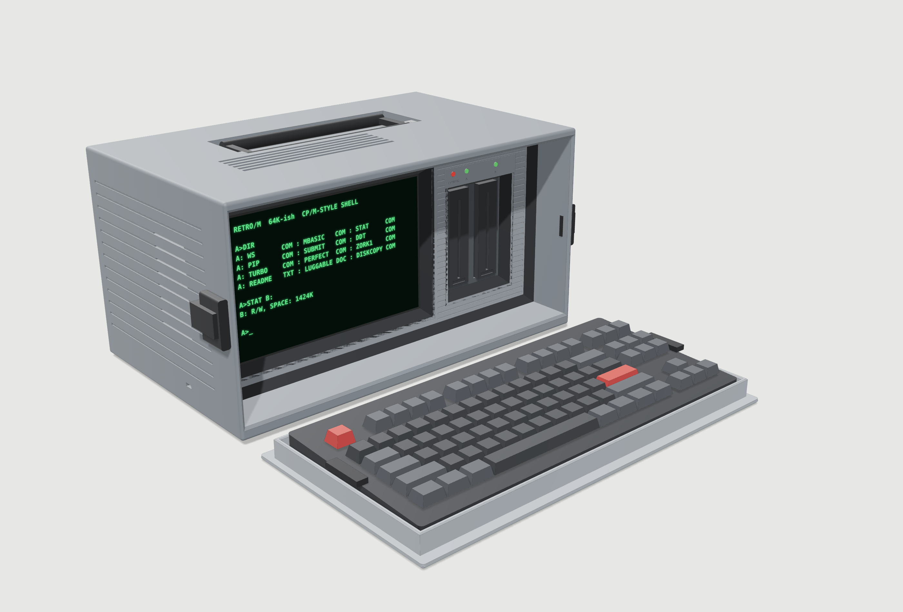
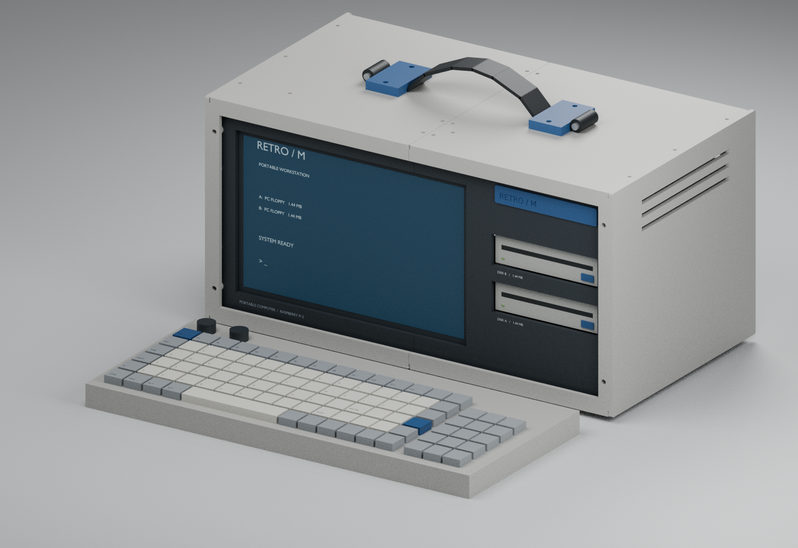

# Retro / M — Raspberry Pi luggable enclosure

**Current direction: P2 concept, a Kaypro II / Kaypro 10-style luggable.** It has a recessed, angled "shielded" front, a keyboard housing that latches over the screen as the lid, two vertical floppy drives, a rear I/O panel and a rear diskette drawer. See **[docs/concept-P2.md](docs/concept-P2.md)**, open `outputs/p2/viewer.html` in a browser, or rebuild with `./rebuild-p2.sh`.



The P1 printable prototype below is the earlier flat layout. It is kept for reference and for its fastener and fit details.

**P1 is now a detailed, printable reference-hardware prototype.** It includes 42 printed assembly pieces, seven fit coupons, a recessed screen fascia, two-drive cage, adjustable hub cradle, removable rear panels, front keyboard carrier, and bolted handle reinforcement. It is separate from the operating-system project.

The shell is 400 × 200 × 220 mm (W × H × D); with carrier it is 400 × 200 × 284 mm, excluding feet, handle and screw heads. The styling follows the 8BitDo M Edition gray/blue palette. The intact stock keyboard is retained by padded straps across its underside, not its keys.



## Open or download

Use GitHub **Code → Download ZIP**, extract it, then open:

- **`outputs/prototype/viewer.html`** in Firefox or another WebGL browser for a standalone interactive view; no installation or internet connection is needed after downloading.
- **`outputs/prototype/transport_assembly.step`** in FreeCAD for the assembled CAD with carrier.
- **`outputs/prototype/enclosure_assembly.step`** in FreeCAD for the operating enclosure.
- **`outputs/prototype/parts/*.stl`** in Bambu Studio for individually oriented printable parts. **Print the seven `TEST_*` coupons first.**

The `outputs/prototype/previews` folder contains operating, transport, rear, exploded and front images rendered from the executed CAD. The screen graphics and keyboard key layout are illustrative. `P1-print-files.zip` bundles STLs, the print manifest and assembly guide.

## Build and inspect

Central inputs are in **`parameters.json`**; P1 settings are under `prototype`. Geometry is in `cad/prototype.py`, exported-file checks in `cad/verify_prototype.py`, and rendering in `cad/render_prototype.py`.

Tested with CPython **3.12.14**, build123d **0.10.0**, cadquery-ocp **7.8.1.1.post1**, and Blender **4.3.2**. `requirements.lock` pins the Python dependency closure. Fresh internet installation has not been independently tested.

```sh
cd /path/to/retro_machine_cad
python3.12 -m venv .venv
. .venv/bin/activate
python -m pip install -r requirements.lock
./rebuild-prototype.sh
blender -b -t 4 -P cad/render_prototype.py
```

In the prepared cloud environment the dependencies already exist. Use its existing checkout; each task is isolated, so do not create a Git worktree unless requested. No background services are required. On Windows, activate `.venv\Scripts\activate` and run `python cad/prototype.py` then `python cad/verify_prototype.py` and `python tools/package_prototype.py`; Bash is not necessary. Rendering is optional for editing/exporting CAD.

## Read before fabrication

**[Detailed P1 guide, hardware list, print notes and assembly order](docs/prototype-P1.md)**

The supplied manufacturer display drawing was inspected and transcribed. New manufacturer website research was blocked by the environment's network policy. The TEAC-class drive, cooler, Pi connector geometry, hub and detailed keyboard contacts therefore remain explicitly provisional reference choices. This is not a validated purchasing recommendation or a production-ready fit guarantee.

Exact CAD interference tests, STEP reimport and STL watertightness/volume/size checks pass for the documented model. All oriented printed parts fit within a 250 mm extent, conservatively using the A1's nominal 256 mm volume rather than an unverified H2C specification. Slicer toolpaths, physical fit, temperatures and handle strength have **not** been validated. The handle requires the modeled metal backing bar, steel crosspins, properly sewn webbing and physical load testing; it has no claimed load rating.

The earlier `cad/layout.py`, `rebuild.sh`, and `outputs/layout_*.step` are the previous envelope milestone. **Use `outputs/prototype` for the current design.**
