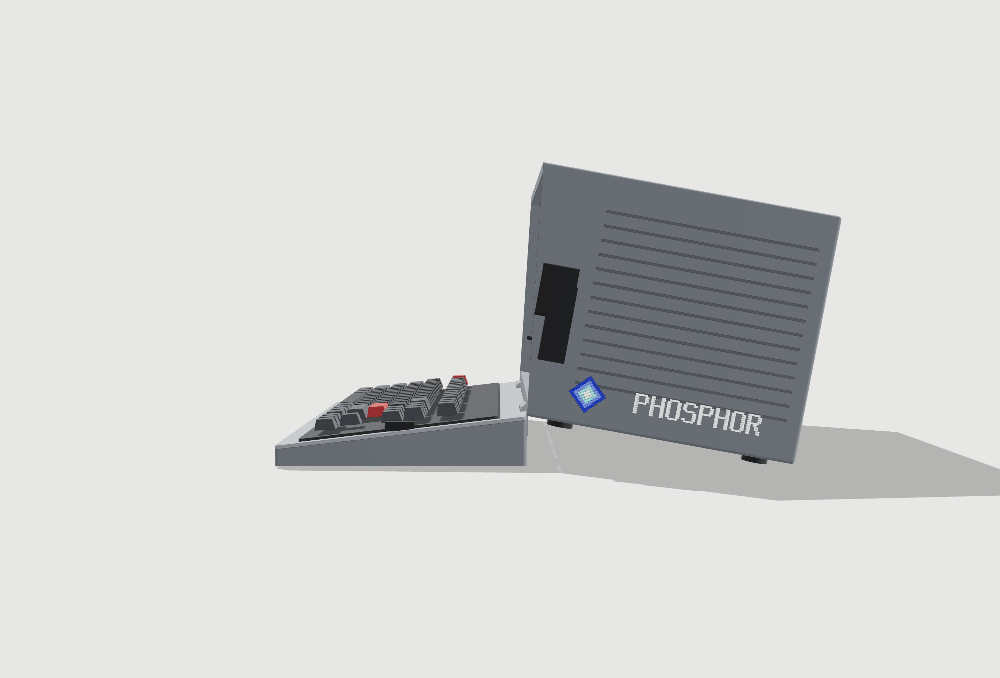
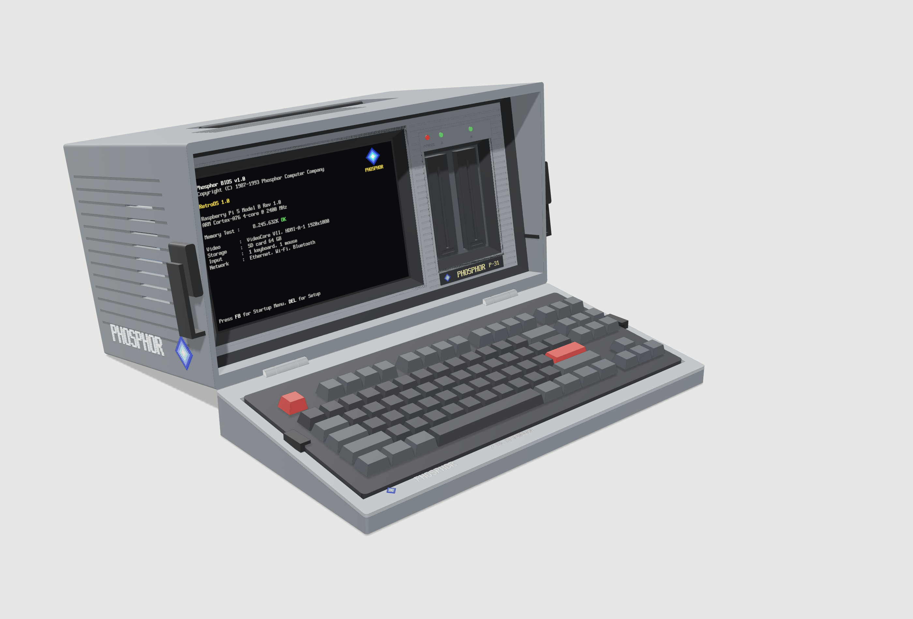
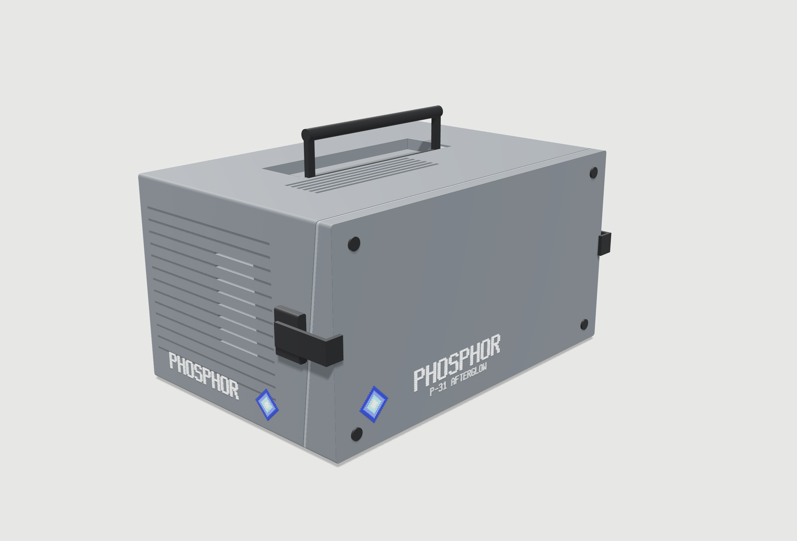
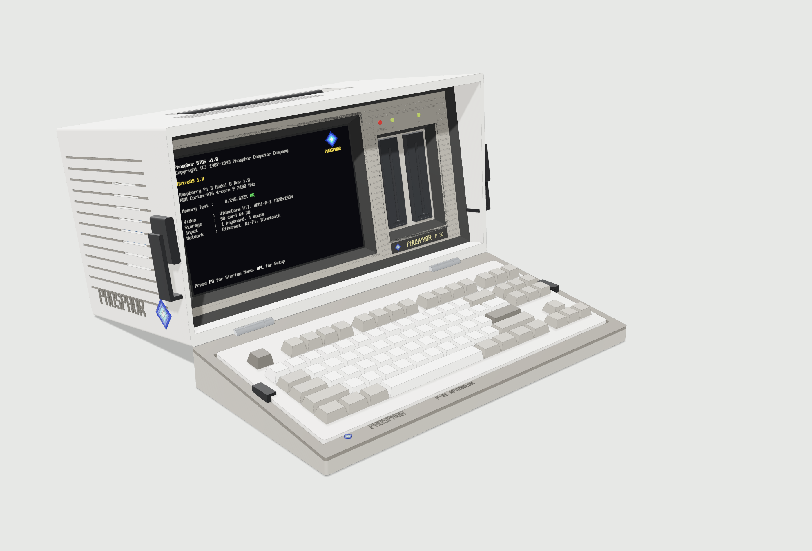

# P2 concept: Kaypro-style luggable (rev C + branding)

**Rev C changes:** the wedge lid is now **hinged** to the bottom front edge of the case with a pair of lift-off hinges at x = 70 and 330 mm. The hinge axis is on the lid's thick rear edge, at deck height (41.7 mm above the desk when open). Folding the lid down onto the desk therefore **lifts the front of the case**. The case pivots on its rear feet and tilts back **10.3°**, which angles the screen and touchscreen up toward the user, and the lid becomes the foot. The tilt angle comes out of the wedge geometry rather than being set directly. The front feet now sit behind the slanted lip; when the case is open they lift off the desk. Lift-off pins still let you detach the keyboard if you want.

**Rev B changes:** the keyboard housing is now a Kaypro-style **wedge**: 17 mm tall at the front and 41 mm at the rear, with the deck at 6.7°. The deck angle is the 8BitDo's own case slope plus a 4° platform tilt (`p2.tray.platform_tilt_deg`). The **case lip is cut on the same slant**: the lip sits 13 mm behind the closed lid's front face at the top and 38 mm at the bottom, so the case reaches further forward at the top. When closed, the wedge meets the lip flush, and the underside of the lid becomes the vertical front face, as on the Kaypro. In use, the wedge gives the keyboard its typing tilt. The side grooves now carry inlays, which show as blue stripes in the classic colourway. There is also a third colourway that pairs the charcoal case with the stock 8BitDo M colours. Its colours are approximate and come from the P1 palette.

P2 replaces the flat P1 "box with a carrier" layout with a massing based on the Kaypro II and Kaypro 10. The P1 files in `outputs/prototype` are still there for reference, but P2 is now the direction for the design.

This is a **concept model**. It sets the overall form, the transport scheme and where the internals go. It is not yet split into printable parts (see "Next steps").

## What changed from P1 and why

| Request | P2 answer |
|---|---|
| Kaypro "shielding" around the screen and drives | The front panel sits **67 mm back** inside a hood made by the top, sides and base. An **angled shield ring** (8 mm at 45°) joins the hood walls to the fascia. Inside that, the screen and the drive pair each have their own **angled frustum surround**, like the Kaypro CRT bezel. The glass and drive faces sit another 10 mm back. |
| Keyboard covers the display when closed | The keyboard sits in a **wedge housing that is also the front lid**. In use it is the keyboard base, with its grey deck around the keys. For carrying, you flip it keys-inward. Its sloped deck meets the slanted case lip, its 400 × 210 underside becomes the front face, and two **side latches** hook over the front edge. The keyboard is held in by two swing clips over its case edge. |
| Not flat | The design has a recessed fascia, angled shrouds, Kaypro 10-style horizontal grooves beside the drives, a ribbed side wrap, top louvres, a recessed handle tub and an inset rear panel. |
| 2 floppies, vertical, side by side | Two drives (Sony MPF920 envelope, 101.6 × 25.4 × 150) stand vertically to the right of the screen, with POWER / A / B LEDs above. |
| USB hub out the back | A hub envelope sits on a shelf above the drive cage. Its ports, plus HDMI, RJ45, USB-C power in and a rocker switch, are on the rear I/O plate. |
| Use empty space for storage | The space behind the screen holds a **rear pull-out drawer**. It has a diskette file on the left (about 26 3.5" disks standing on edge) and an accessory/cable bin on the right. |
| Darker keyboard | The renders use charcoal keycaps. The housing and keyboard envelope are sized from the 8BitDo M Edition dimensions (376.6 × 169.6 × 46.8). |

There are four colourways in the viewer:

- **charcoal** (Kaypro 10-like)
- **classic** (Kaypro II-like off-white with blue)
- **charcoal + stock 8BitDo**, to judge the light keyboard against the dark case
- **M Edition match**: an off-white case, a warm-grey fascia and keyboard deck, and the keyboard in its stock white, warm-grey and dark-grey keys.

The 8BitDo colours were picked by eye from a product photo, not measured, so expect to tune them against real filament samples.

## Branding: Phosphor Computer Company

The case is branded for the fictional **Phosphor Computer Company** (PCC), which "makes" RetroOS. The branding follows RetroOS's own style guide (`docs/STYLE.md` in the RetroOS repo): "one product, one hand", so the case uses the OS's logo, font and palette rather than artwork invented for the case.

**The brand system** (`p2.branding.style = "os"`, the default):
- **Logo:** the Phosphor BIOS mark, a "glowing phosphor dot" built from concentric pixel diamonds in Cobalt `#1F3BB3`, Sky `#5C7CFA`, Aqua `#5FE3E3` and White `#F5F5F0`. The diamond geometry is the same 25-pixel stepped shape that `retro-post` draws.
- **Wordmark:** "PHOSPHOR" built from RetroOS's own **Phosphor Mono 8×16** pixel font (SIL OFL 1.1, vendored in `tools/vendor/phosphor-mono`). Each pixel is a raised printed square.
- **Nameplate:** the dark front-panel plate copies the POST-screen logo: the diamond plus "PHOSPHOR" in Lemon `#F7E15A` on black.
- The earlier italic speed-stripe wordmark with green/amber/blue bars is still available as `style = "stripes"`, but it is no longer the default.

**Where it appears:**

| Place | What |
|---|---|
| Both sides | A Phosphor Mono wordmark (1.7 mm pixels) low over the ribs, with the diamond ahead of it. |
| Closed lid (front face) | A large diamond and wordmark plus "P-31 AFTERGLOW". |
| Keyboard deck | A small diamond, wordmark and model on the front band. |
| Front panel | The dark nameplate under the drives with the diamond, "PHOSPHOR" in Lemon, and the model number. |
| Rear I/O plate | "PHOSPHOR COMPUTER COMPANY" and the model/RetroOS line, engraved. |
| Screen | The **Phosphor BIOS POST screen**, redrawn from the RetroOS source (see below). |

**POST screen on the model:** `tools/render_post_screen.py` redraws the `retro-post` POST screen at the Touch Display 2's 1920×1200 resolution (integer scale 3, an exact 80×25 fit). It transcribes the layout and colours of `post_grid`/`draw_logo`, uses the sample data from `probe::fake()`, and draws in the Phosphor Mono font. The result is `outputs/p2/screens/post.png`, which the viewer and renders use. It is a re-drawing, not output from the real binary, so compare it with a real screenshot. On the real machine the Video line will report the DSI panel instead of HDMI.

**Printing notes:**
- The raised logo layers (0.4–0.8 mm) are meant to be printed as AMS colour swaps or as separate inlays.
- The smallest pixels (about 0.34 mm, on the deck and nameplate diamonds) are below a 0.4 mm nozzle line width. Scale those up, or print the deck/nameplate badges as separate parts, for example on a 0.2 mm nozzle.

### Model name ideas

These are grouped by theme. ★ marks my favourites.

**From the RetroOS lore** (the strongest fit)
- ★ **PCC Model 5 Portable**: RetroOS's design doc already shows the POST line `PCC Model 5 — ARM Cortex-A76…` for the Pi 5. The lore also says PCC shipped the **Model 1** in 1984, so the Pi 5 luggable is naturally the **Model 5**. The portable could be **Model 5P** or **Model 5 Portable**, with "P-31" kept as a nod in the colourway or the screen theme.
- **Model 5 Executive**, **Model 5 Transportable**

**CRT / phosphor science**
- ★ **P-31 Afterglow**: P31 is the green phosphor used in classic monochrome terminals, and "afterglow" is the term for phosphor persistence. This is the current placeholder.
- ★ **Persistence 10**: phosphor persistence, plus the 10.1" screen. It also hints at "a computer that lasts".
- **Raster**, **Scanline 2**, **Raster Portable**
- **Kilovolt** / **KV-10**, after the CRT's anode voltage
- **Glow / Glowcase**, **Lumen 10**
- **P3 Amber**, which works as a special-edition name (an amber screen theme in RetroOS)

**Luggable / travel** (period marketing tone)
- ★ **Courier**: an era-perfect name for a portable. Watch out for confusion with the Courier typeface.
- **Nomad 10**, **Voyager DD**, **Attaché**, **Carryall**, **Field Unit**, **Expedition**

**80s spec-sheet style** (numbers and letters, the way they were really sold)
- **DD-2** (dual drive), **PX-10** (Phosphor eXecutive, 10")
- **Model 1031** (10.1" screen, P31 phosphor)
- **Executive Portable**, **Dual Drive Portable**

**Pi nods** (hidden in plain sight)
- **Pi-Lot**, **Model 314**, **Five** (for the Pi 5), **Tau** (the Pi joke for insiders)

Suggestions for pairing names:
- Use **company + number + name** on the hardware, for example **Phosphor P-31 Afterglow** or **Phosphor PX-10 Courier**.
- Keep a short code (P-31) for the nameplate and the full name for the lid and screen.
- A family scheme also works: P-31 for green and P-3 "Amber Edition" for a second colourway or screen theme.

I have not checked any of these names against existing trademarks or products. Phosphor is fictional, but do a quick search before you print anything you plan to sell or share widely.

## Key dimensions (from `outputs/p2/validation.json`)

- Case: **400 W × 210 H × 265 D mm**, plus 6 mm feet.
- Closed, including lid and latches: **426.0 × 216.0 × 274.0 mm**. The raised handle is extra.
- Keyboard wedge: 400 × 210 mm, 17 mm tall at the front and 41 mm at the rear (deck 6.7°). With the keys it stands about 53 mm tall.
- Hood opening: 390 × 189 mm. The slanted lip sits 13 mm behind the closed lid's front face at the top and 38 mm at the bottom.
- Fascia plane: 67 mm behind the lid's front face. With the full 46.8 mm spec height applied over the whole tilted keyboard (deliberately pessimistic), the closed keyboard leaves **8.5 mm** to the fascia.
- Screen glass: 77 mm back. The visible active window is 216.6 × 135.4 mm (Touch Display 2, 10.1").
- Pi 5 sits on the display's inner 58 × 49 M2.5 pattern. Behind the Active Cooler there is an air gap before the drawer, which starts at y = 143 mm.
- Open (lid folded down): the case tilts back **10.3°** on its rear feet, carried by the hinged lid. Hinge axis: y = 37.7 mm, at the case bottom.
- Operating footprint: about 541 mm deep from the front of the keyboard to the back of the case.

All of the clearance and interference checks in `validation.json` pass. These cover the open lid and hinges against the case, both resting on the desk with nothing below it, the closed lid against the front parts and the slanted lip (0.6 mm gap), the keyboard seated in the wedge and clips, the drawer (in and pulled out) against the internals, the drives, the display/Pi, and the handle in both positions.

## Hardware assumptions to confirm

These are envelopes, not product models:

1. **Sony MPF920 size and mounting.** I used 101.6 × 25.4 × 150 mm. The real side screw positions and front bezel are needed before the cage is detailed. The MPF920 is a 34-pin drive, so it needs a USB floppy controller (a Greaseweazle-class board, 60 × 50 envelope under the drives). One twisted cable serves both A and B.
2. **8BitDo profile.** Only the overall box (376.6 × 169.6 × 46.8) is a real input. Its case-top slope (17 → 25 mm) is a guess and drives the deck angle. The keycaps are an illustrative TKL layout. If you change to a different charcoal keyboard, its height is what sets how deep the fascia sits. Its width and depth set the hood and lid size.
3. **Power.** A 5 V distribution / USB-C PD input envelope (about 70 × 48 × 24) feeds the Pi, the hub and the drives. You still need to choose the actual parts.
4. **USB hub.** The model reserves an 79 × 72 × 26 mm envelope with its ports facing the rear.
5. **Touch near the screen edges.** The 10 mm deep, 45° frustum gives a Kaypro look, but it may make the outermost few mm of the touch area awkward to reach. The depth and slope are parameters (`p2.screen_shroud`).

## Open design questions

- **Handle.** P2 uses a fold-flat bail handle in a top tub, pivoting about 136 mm behind the lip, roughly over the centre of mass with the lid on. A side strap handle is another option.
- **Hinge.** A concept-level knuckle pair. It still needs a real hinge part, which could be a printed knuckle with a steel pin or a stock lift-off hinge. It also needs a check that the lid can carry the case's front load. Any change to the wedge's rear height changes the open tilt.
- **Wedge angle.** At 6.7° it is shallower than a real Kaypro (which looks closer to 10–15°). Raising `platform_tilt_deg` steepens both the deck and the case lip together, but it pushes the fascia back, makes the keyboard sit higher, and also increases the open case tilt.
- **Keyboard link.** The 8BitDo works over 2.4 GHz or Bluetooth, so there is no fixed cable. There is a USB-C port on the left side for wired use or charging, and a cable notch in the lid rim.
- **Branding.** The case uses the project name "RETRO / M". It deliberately avoids Kaypro marks.

## Next steps (P2-detail)

1. Agree on the form, proportions and colourway.
2. Get real drawings or measurements of the MPF920, the chosen keyboard and the hub.
3. Split the shell, fascia, lid and drawer to fit a 256 mm print bed. P1's seam strips and captive nut pockets can be reused.
4. Design the latch mechanism and the lid-rim alignment features, then print fit coupons.

## Files

- `cad/p2_concept.py`: parametric build123d model. The inputs are in `parameters.json` under `p2`.
- `outputs/p2/p2_operating.step`, `outputs/p2/p2_closed.step`: assemblies for FreeCAD or other CAD tools.
- `outputs/p2/viewer.html`: offline 3D viewer. Open it in any browser to switch between operating, closed, rear/drawer and X-ray views and between the two colourways, and click parts for their notes.
- `outputs/p2/previews/*.png`: renders from the viewer.
- `outputs/p2/validation.json`: dimensions and clearance checks.
- Rebuild with `./rebuild-p2.sh`. This needs the `requirements.lock` venv, and Node with Playwright for the PNGs.
